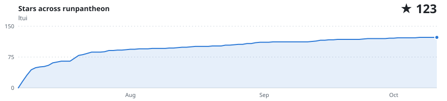

<div align="center">


# Pantheon

**The Unified Inbox & CRM** · Telegram, WhatsApp, iMessage & X/Twitter

<br>

Your chats become a CRM that updates itself.<br>
Contacts, companies and deals stay current from the conversations you're already having.

<br>

<a href="https://app.pantheon.run"><b>Open the app</b></a> &nbsp;·&nbsp;
<a href="https://pantheon.run/download"><b>Download for Mac</b></a> &nbsp;·&nbsp;
<a href="https://docs.pantheon.run"><b>Docs</b></a> &nbsp;·&nbsp;
<a href="https://www.npmjs.com/package/runpantheon"><b>npm</b></a>

<br><br>

<a href="https://www.npmjs.com/package/runpantheon"></a>
<a href="https://docs.pantheon.run/guides/connect-ai-agent"></a>
<a href="https://github.com/runpantheon/pantheon/discussions"></a>

</div>

<br>

<div align="center">

## What Pantheon does

<sub>Your conversations, turned into a relationship system of record</sub>

</div>

<table>
<tr>
<td width="50%" valign="top">

**One inbox for every chat**<br>
<sub>Telegram, WhatsApp, iMessage and X/Twitter side by side, with each person's history kept together across channels.</sub>

</td>
<td width="50%" valign="top">

**A CRM that updates itself**<br>
<sub>Conversations build and update your contacts, companies and deals, so nobody keeps the CRM by hand.</sub>

</td>
</tr>
<tr>
<td width="50%" valign="top">

**Milo, your assistant**<br>
<sub>Drafts replies, remembers context and turns everyday conversations into structured relationship data.</sub>

</td>
<td width="50%" valign="top">

**Works with your AI tools**<br>
<sub>Connect Claude, ChatGPT, Cursor and other AI tools to your Pantheon account through the MCP server, CLI and developer API.</sub>

</td>
</tr>
</table>

<br>

<div align="center">

## Quick install

<sub>Bring Pantheon into your AI tools and your terminal</sub>

</div>

**No install:** paste `https://mcp.pantheon.run/mcp` into Claude or ChatGPT → Settings → Connectors.

**Command line:**

```sh
curl -fsSL https://pantheon.run/install.sh | sh     # macOS / Linux
irm https://pantheon.run/install.ps1 | iex          # Windows (PowerShell)
npm install -g runpantheon                          # or with npm (Node 18+)
```

Then run `pantheon setup` to sign in and add Pantheon to the AI apps on your computer. See the [CLI on npm](https://www.npmjs.com/package/runpantheon) and the [setup guide](https://docs.pantheon.run/guides/connect-ai-agent).

<br>

<div align="center">

## Get help

</div>

- **Something broken?** [Open a bug report](https://github.com/runpantheon/pantheon/issues/new?template=bug_report.yml).
- **Want something?** [Request a feature](https://github.com/runpantheon/pantheon/issues/new?template=feature_request.yml) or [ask for a channel](https://github.com/runpantheon/pantheon/issues/new?template=channel_request.yml).
- **A question or an idea?** [Start a discussion](https://github.com/runpantheon/pantheon/discussions) or join the [community](https://t.me/+kI_2JfOEgNwxM2M5).

<br>

<div align="center">

## Open source

<sub>Tools we build in the open, free to use</sub>

<br><br>

### ltui

<sub>Linear in your terminal: status-grouped tickets, instant startup, full keyboard and mouse</sub>

<br><br>

<a href="https://github.com/runpantheon/ltui">
  
</a>

<br><br>

### The tracker suite

<sub>The same fast terminal UI for each tracker your team uses</sub>

</div>

<table>
<tr>
<td width="33%" align="center" valign="top">
<a href="https://github.com/runpantheon/ltui/tree/main/ltui"></a>
<br>
<b>◐ ltui</b><br>
<sub>for Linear</sub>
</td>
<td width="33%" align="center" valign="top">
<a href="https://github.com/runpantheon/ltui/tree/main/jtui"></a>
<br>
<b>◑ jtui</b><br>
<sub>for Jira</sub>
</td>
<td width="33%" align="center" valign="top">
<a href="https://github.com/runpantheon/ltui/tree/main/sctui"></a>
<br>
<b>◐ sctui</b><br>
<sub>for Shortcut</sub>
</td>
</tr>
</table>

<div align="center">
<sub>Runs on Linux, macOS and Windows. Install one with:</sub>
</div>

```sh
pipx install "git+https://github.com/runpantheon/ltui#subdirectory=ltui"    # or jtui, sctui
```

<br>

<div align="center">

### ricekit

<sub>The design system behind the suite</sub>

</div>

<table>
<tr>
<td width="45%" valign="middle">
<a href="https://github.com/Gheat1/ricekit"></a>
</td>
<td width="55%" valign="middle">

**🍚 [ricekit](https://github.com/Gheat1/ricekit)**<br>
<sub>Themes, widgets, modals, icons and the design rules for building a fast, clean <a href="https://github.com/Textualize/textual">Textual</a> app. By <a href="https://github.com/Gheat1">@Gheat1</a>.</sub>

</td>
</tr>
</table>

<br>

<div align="center">

### Star history

<sub>GitHub stars across runpantheon's public repositories</sub>

</div>

<a href="https://github.com/orgs/runpantheon/repositories">
  <picture>
    <source media="(prefers-color-scheme: dark)" srcset="https://raw.githubusercontent.com/runpantheon/.github/main/profile/stars-dark.svg" />
    
  </picture>
</a>

<br>

<div align="center">

## Get in touch

<sub>For teams and enterprise</sub>

<br>

<a href="https://pantheon.run">pantheon.run</a> &nbsp;·&nbsp;
<a href="mailto:enterprise@pantheon.run">enterprise@pantheon.run</a> &nbsp;·&nbsp;
<a href="https://x.com/runpantheon">X</a> &nbsp;·&nbsp;
<a href="https://www.linkedin.com/company/runpantheon">LinkedIn</a>

<br><br>

<sub>© 2026 Pantheon Labs. All rights reserved.</sub>

</div>
